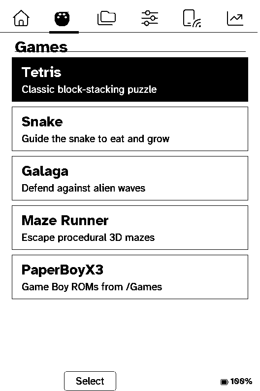
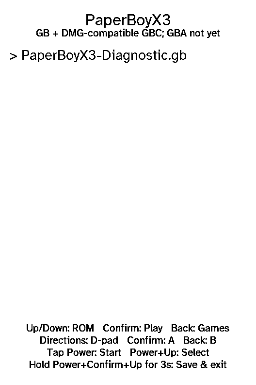
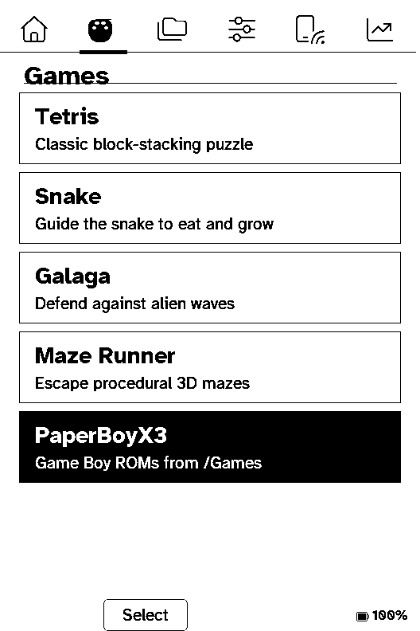

# Simulator test of 1.17.8 (X3)

Branch `1.17.8`, desktop simulator built as an X3 (`pio run -e simulator_x3`), *Project Hail Mary* (2021 EPUB, 41 spine items) in `fs_/books/`. Date: Nov 24, 2026.

| Test | Result |
| --- | --- |
| 1. Chapter 1 (spine 6, `c001`) heading image | **Pass**: extracted, laid out and drawn |
| 2. Last chapter (`c030`, logged as spine 35) | **Pass**: builds, heading image drawn |
| 3. Games → PaperBoyX3 → ROM list → Back | **Pass**: list shows the diagnostic ROM; Back returns to Games |
| 4. Heading image fails to extract (forced) | **Pass**: `6.bin.retry` written; next visit rebuilds the chapter and the heading returns |
| 5. Rebuild of a marked chapter fails (forced) | **Pass**: earlier layout kept, marker kept, no restart |
| 6. Uncached chapter fails to build (forced) | **Partly shown**: `[CHR]` restart fires; the post-restart resume cannot run in the simulator |

Screenshots are cropped to the heading strip so they don't reproduce the book's text. Full serial logs are in `logs/`.

## What the simulator cannot show

The simulator's heap is the host's: about 1 MB is reported free and a 32 KB block is always available. The X3 has 320 KB and no PSRAM, and its failures come from fragmentation. **Tests 1 and 2 passing here does not show the heading fix works on the device.** They show the code path is correct when memory is available.

Tests 4–6 force the failure with `failmalloc`, which refuses chosen `malloc()` sizes. That exercises the retry-marker, rebuild and restart logic. It does not reproduce *when* the X3's heap fragments, or whether taking the inflate window first (the ZipFile change) helps on a real heap.

`ChapterRestart` calls `abort()` in the simulator, and `RTC_NOINIT_ATTR` variables do not survive a process exit. So the restart→resume hand-off (`consumeResumeRequest`) is not exercised. After relaunching, the book reopened at spine 6 through `APP_STATE.lastRead` and saved progress, not through ChapterRestart.

## 1. Chapter 1 heading (cold cache)


```
[EBP] Zip Request: OEBPS/xhtml/Weir_9780593135211_epub3_c001_r1.xhtml
[40640] [ZIP] Decompressed 13331 bytes into 39057 bytes
[40640] [SCT] createSectionFile: temp HTML extract attempt=1 ok=1 bytes=39057 spine=6 href=OEBPS/xhtml/Weir_9780593135211_epub3_c001_r1.xhtml …
[EBP] Zip Request: OEBPS/images/Weir_9780593135211_epub3_004_r1.jpg
[40642] [ZIP] Decompressed 76735 bytes into 144242 bytes
[40657] [EBP-IMG] cache hit /.metadata/epub/18276938335300208939/images/Weir_9780593135211_epub3_004_r1.jpg
[EHP] Image ../images/Weir_9780593135211_epub3_004_r1.jpg - CSS: , Final: 482x36 (actual: 6776x516, percent: w=0 h=0)
[40796] [SCT] parseAndBuildPages success internal=OEBPS/xhtml/Weir_9780593135211_epub3_c001_r1.xhtml finalY=55 heap=1048576
```

`cache hit` is logged after a fresh extraction too: it is the check that follows the decompress above it.

## 2. Last chapter


`c030` is spine index 35 (zero-based; the brief's "spine 36" counts from one). No `[EPA]` or `[CHR]` lines.

```
[EBP] Zip Request: OEBPS/xhtml/Weir_9780593135211_epub3_c030_r1.xhtml
[99542] [ZIP] Decompressed 6021 bytes into 15763 bytes
[99542] [SCT] createSectionFile: temp HTML extract attempt=1 ok=1 bytes=15763 spine=35 href=OEBPS/xhtml/Weir_9780593135211_epub3_c030_r1.xhtml …
[EBP] Zip Request: OEBPS/images/Weir_9780593135211_epub3_033_r1.jpg
[99543] [ZIP] Decompressed 101387 bytes into 174658 bytes
[EHP] Image ../images/Weir_9780593135211_epub3_033_r1.jpg - CSS: , Final: 482x35 (actual: 6922x505, percent: w=0 h=0)
[99599] [SCT] parseAndBuildPages success internal=OEBPS/xhtml/Weir_9780593135211_epub3_c030_r1.xhtml finalY=202 heap=1048576
```

## 3. PaperBoyX3

Tab 2 Content set to Games in Settings → Display. `fs_/Games/` holds `PaperBoyX3-Diagnostic.gb` from the PaperBoyX3 project.

  

PaperBoy runs as a sub-activity of Games, so it logs no `[SIM] Activity` line.

## 4. Retry marker: heading image refused, then restored

Section 6 and the cached heading image were deleted, then the chapter was entered with `failmalloc 2 32768 32768 1`: let the chapter's own 32 KB inflate window through, refuse the next two. The parser asks for the image twice (size probe, then placement), so refusing only one still produced a complete layout. That is worth knowing: a single failed window does not drop the heading.


```
[SIMCTL] failmalloc: refused malloc(32768), 1 left
[80706] [ZIP] Failed to allocate memory for dictionary: free=1048576 largest=0
[80706] [EBP-IMG] ensureImageCached failed href=OEBPS/images/Weir_9780593135211_epub3_004_r1.jpg
[SIMCTL] failmalloc: refused malloc(32768), 0 left
[80714] [ZIP] Failed to allocate memory for dictionary: free=1048576 largest=0
[80714] [EBP-IMG] ensureImageCached failed href=OEBPS/images/Weir_9780593135211_epub3_004_r1.jpg
[80714] [EBP-IMG]  not placed src=../images/Weir_9780593135211_epub3_004_r1.jpg …
[80837] [SCT] parseAndBuildPages success … finalY=738
[80838] [SCT] spine=6 cached without 1 image(s); build 1 of 3
```

The chapter had 48 pages and `sections/6.bin.retry` held `01`. After paging back to spine 5 and forward again, with nothing armed:


```
[96740] [EPA] loadSection: spine=6 was cached without images; building again
[96749] [ZIP] Decompressed 76735 bytes into 144242 bytes
[EHP] Image ../images/Weir_9780593135211_epub3_004_r1.jpg - CSS: , Final: 482x36 (actual: 6776x516, percent: w=0 h=0)
[96883] [SCT] parseAndBuildPages success … finalY=55
```

49 pages; the marker was removed.

## 5. Rebuild of a marked chapter fails

The marker was recreated as in test 4, then the chapter was entered with `failmalloc 3 32768 32768`, which refuses all three extraction attempts of the chapter itself:

```
[123555] [EPA] loadSection: spine=6 was cached without images; building again
[123560] [ZIP] Failed to allocate memory for dictionary: free=1048576 largest=0
[123560] [SCT] createSectionFile: temp HTML extract attempt=1 ok=0 …
[123611] [SCT] createSectionFile: temp HTML extract attempt=2 ok=0 …
[123662] [SCT] createSectionFile: temp HTML extract attempt=3 ok=0 …
[123666] [EPA] loadSection: rebuild of spine=6 failed; keeping the earlier layout
```


The reader showed the earlier 48-page layout, without the heading. `6.bin` and `6.bin.retry` were kept, and the marker still read `01`: a failed rebuild does not count against the three tries.

## 6. Uncached chapter fails to build → ChapterRestart

`sections/6.bin*` deleted, then the chapter was entered with `failmalloc 3 32768 32768`:

```
[141960] [SCT] createSectionFile: temp HTML extract attempt=3 ok=0 …
[141965] [EPA] loadSection: build failed spine=6 total=41
[141965] [EPA] loadCurrentSection: build failed spine=6, not walking further
[141967] [CHR] restarting to open spine=6 of /books/Project Hail Mary 2021 by Andy Weir 2.epub on a fresh heap
```

The process then exits (the simulator's `abort()`). The book cache survived (`book.bin`, `progress.bin`, the other sections). Relaunching opened the reader at spine 6, which built normally with its heading:


## Bugs the simulator exposed (fixed on this branch)

- **Opening a book from the Library read a freed string** (`3cbff3a`). `switchTo` deletes the Library activity, including the `item.path` the reader was about to be built from, before constructing the reader. The simulator's allocator overwrote it and every Library open bounced straight back. It has been in `main.cpp` since v1.0.0; on the device it works only while that freed block isn't reused.
- **`book.bin` read back wrong on a 64-bit host** (`2d25258`). `lutOffset` is written as `uint32_t` and was read into a `size_t`. No device change: `size_t` is 32 bits on the ESP32-C3.

## Running the simulator

```bash
pio run -e simulator_x3 -t run_simulator
```

`simulator` is the X4 panel. Put books in `fs_/books/` (gitignored). To drive it from a script or an agent:

```bash
mkfifo /tmp/sim && EINX_SIM_CONTROL=/tmp/sim .pio/build/simulator_x3/program > serial.log 2>&1 &
printf 'key confirm\nwait 2000\nshot page.png\nfailmalloc 2 32768 32768 1\n' > /tmp/sim
```

Commands are documented at the top of `src/simulator/SimControl.cpp`. Injected key presses arrive as SDL events without keyboard state. Long presses therefore don't register, and presses sent faster than about one every 250 ms can be dropped while the reader is busy.
